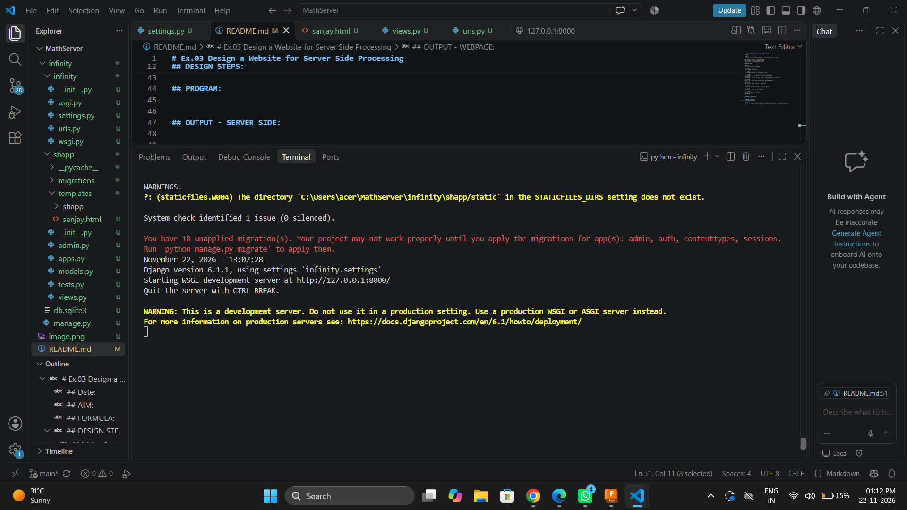
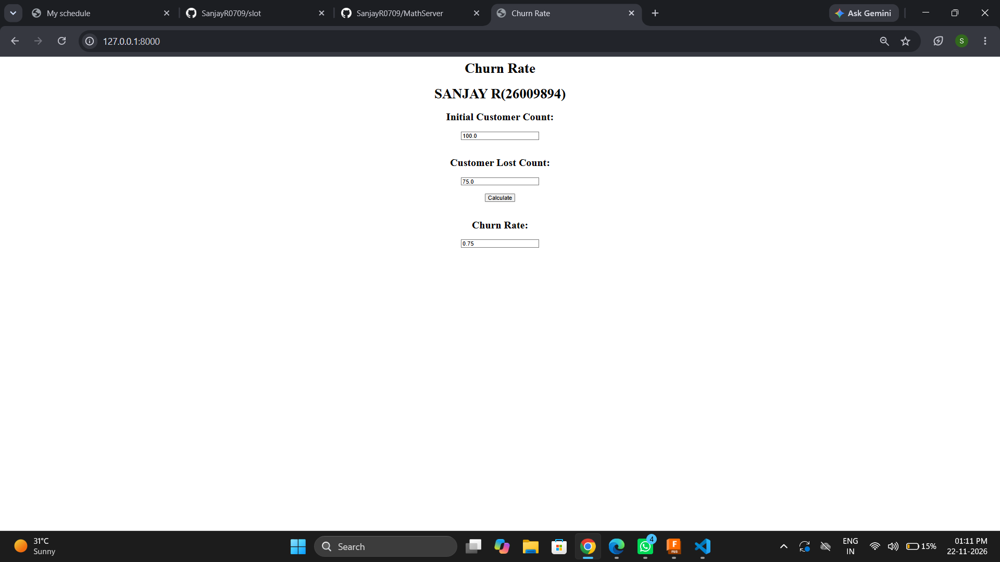

# Ex.03 Design a Website for Server Side Processing
## Date:

## AIM:
To create a web page to calculate Churn Rate using server-side scripts.

## FORMULA:
Churn Rate = (CustLost / InitCust) * 100
<br> InitCust --> Initial Customers Count
<br> CustLost --> Customers Lost Count

## DESIGN STEPS:

### Step 1:
Clone the repository from GitHub.

### Step 2:
Create Django Admin project.

### Step 3:
Create a New App under the Django Admin project.

### Step 4:
Create a HTML file to implement form based input and output.

### Step 5:
Create python programs for views and urls to perform server side processing.

### Step 6:
Receive input values from the form using request.POST.get().

### Step 7:
Calculate the Result using the given formula.

### Step 8:
Display the calculated result in the server console.

### Step 9:
Render the result to the HTML template.

### Step 10:
Publish the website in Localhost.

## PROGRAM:
html
```
html
<html>
    <head>
        <title>Churn Rate</title>
    </head>
    <body>
        <h1 align="center">Churn Rate</h1>
        <h1 align="center">SANJAY R(26009894)</h1>
        <form method="POST" align="center">
            
            <label><h2>Initial Customer Count:</h2></label>
            <input type="text" value="{{InitCust}}" name="Initial_Customer_Count"><br><br>
            <label><h2>Customer Lost Count:</h2></label>
            <input type="text" value="{{CustLost}}" name="Customers_Lost_Count"><br><br>
            <input type="submit" value="Calculate"><br><br>
            <label><h2>Churn Rate:</h2></label>
            <input type="text" value="{{cr}}"><br><br> 
        </form>
    </body>
</html>

python
from django.shortcuts import render
def churn_rate(request):
    InitCust= float(request.POST.get('Initial_Customer_Count', '0'))
    CustLost=float(request.POST.get('Customers_Lost_Count', '0'))
    cr = (CustLost/InitCust) if InitCust !=0 else 0
    print("Initial Customer =",InitCust)
    print("Present Customer =",CustLost)
    print("Churn Rate =",cr)
    return render(request, 'sanjay.html',{'InitCust': InitCust, 'CustLost': CustLost, 'cr': cr})

    from django.contrib import admin
from django.urls import path
from shapp import views

urlpatterns = [path('', views.churn_rate, name='churn_rate'),]
```

## OUTPUT - SERVER SIDE:


## OUTPUT - WEBPAGE:


## RESULT:
The the web page to calculate Churn Rate using server-side scripts is created successfully.
